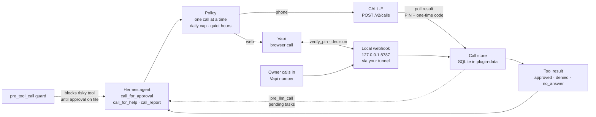

<h1 align="center">Hermes Call Me</h1>

**When Hermes runs on its own, how does it get a real yes from you before it does something it can't undo?**

<p align="center">
  
  
  
  
  
  
  
</p>

<p align="center">
  <b>Hermes plugin</b> · No runtime dependencies · Fails closed: a missing answer is never a yes
</p>

| |
| --- |
| [The problem](#the-problem) · [What it does](#what-hermes-call-me-does) · [How it works](#how-it-works) · [Architecture](#architecture) · [Before you install](#before-you-install) · [Quickstart](#quickstart-browser-demo-near-0) · [Install into Hermes](#install-into-hermes) · [Tools](#the-three-tools) · [Phone calls](#real-phone-calls-call-e) · [Calling Hermes](#when-you-call-hermes) · [Guard](#optional-risky-tool-guard) · [Configuration](#configuration) · [Cost](#test-cost) · [Layout](#repository-layout) · [Checks](#checks) · [Troubleshooting](#troubleshooting) · [Scope notes](#honest-scope-notes) |

## The problem

You leave Hermes running on a deploy, a cleanup or a payments job, and you walk away. Sooner or later it reaches a step that should not happen without you: dropping a table, pushing to production, moving money. It can stop and wait in a terminal nobody is watching, or it can guess.

A chat message is easy to miss and easy to fake. A model reading a transcript can decide you "sounded fine with it". What Hermes needs is a channel that reaches you anywhere and gives back a verdict the server checked, not one the model inferred.

## What Hermes Call Me does

It gives Hermes three tools, and it lets you phone Hermes back:

- **`call_for_approval`.** Before a risky action, Hermes calls you, reads out what will change, and waits for approve or deny.
- **`call_for_help`.** When it is stuck on a production problem, it explains what broke and what it tried, and takes your instructions.
- **`call_report`.** When it finishes, it tells you what it did, what is left and where things stand.
- **Inbound.** You call Hermes's number, pass the PIN and say what you want. That becomes a task for the live session.

Every call starts with your **spoken PIN, which this server compares**. The voice model never knows the PIN. A wrong PIN, silence, a vague answer, a hang-up or the timeout always comes back as **not approved**.

A browser call goes through Vapi: no phone line, close to free, good for a recording. A real phone call goes through CALL-E to **one allowlisted number**.

## How it works

1. **The tool is called.** Hermes calls `call_for_approval(action, risk, summary)`, or one of the other two tools.
2. **Policy check.** Before any provider is contacted, the plugin checks that only one call is active, that the daily cap (default 8) is not reached, that it is outside quiet hours if they are on, and that phone calls are enabled for `channel: phone`. If any check fails, nothing is dialed.
3. **Place the call.**
   - **web:** creates a Vapi browser call. You join it from the local demo page.
   - **phone:** sends `POST /v2/calls` to CALL-E with the task, the one number, a result schema and an `Idempotency-Key`.
4. **Verify the owner.**
   - **Vapi:** the voice agent calls the server's `verify_pin` tool, and only after the PIN matches can it record a decision.
   - **CALL-E:** you say your PIN and repeat a one-time code, and the server compares both against the call result.
5. **Wait, then close.** The tool waits for the webhook or the CALL-E result, up to `call_timeout_seconds` (default 180). A timeout hangs up and returns `no_answer`, and no second call is placed.
6. **Record.** The transcript, decision, cost and duration go into the plugin's SQLite database. Vapi's end-of-call summary is stored for reading only and can never turn a call into an approval.

## Architecture



**Decision rule**, for every channel:

```
approved   PIN matched (by phone, the one-time code too) AND the owner said approve
denied     owner said deny · wrong PIN · wrong code · answer could not be read
no_answer  no answer · busy · silence · hang-up · timeout · error
approved is true only for "approved"; nothing else counts as a yes
```

## Before you install

What the plugin does on your machine, so you can decide before enabling it:

| What | Detail |
| --- | --- |
| **Third-party network calls** | `https://api.vapi.ai` for browser calls, inbound and the optional Vapi phone path. `https://api.heycall-e.com` for real phone calls. The summary you pass, the owner number and the call task go to that provider. The provider processes the call audio; the plugin gets back the transcript, the structured result, cost and duration. |
| **Paid calls** | Calls are billed to your own CALL-E or Vapi account. Phone calls are off until `HERMES_CALL_ME_PHONE_CALLS=1`, they only dial `HERMES_CALL_ME_OWNER_NUMBER`, and the daily cap applies. |
| **Local HTTP server** | The first browser call starts a webhook and demo page in a background thread on `127.0.0.1:8787`; `hermes call-me serve` runs the same server in the foreground. It binds to localhost only. Vapi has to reach it, so you expose it yourself with a tunnel such as `cloudflared`, and every webhook request must carry your `HERMES_CALL_ME_WEBHOOK_SECRET`. |
| **Stored data** | `<HERMES_HOME>/plugin-data/hermes-call-me/data.db` holds transcripts, decisions, costs, durations and owner phone requests. |
| **Credentials** | `VAPI_API_KEY`, `CALLE_API_KEY`, `HERMES_CALL_ME_PIN` and `HERMES_CALL_ME_WEBHOOK_SECRET` are secret fields, read through Hermes's secret store for the active profile. The plugin never reads `.env` files or any other credential store. |
| **Waiting for a person** | A tool call waits at most `call_timeout_seconds` (default 180, max 600), then returns `no_answer`. Unattended runs are not left hanging, and the plugin never approves anything itself. |
| **Inbound** | A PIN-verified call from the allowlisted number is saved as a task and offered to the live session via `ctx.inject_message`, or added on the next turn via `pre_llm_call`. |
| **Not included** | No shell commands, no telemetry, no self-update. |

## Quickstart (browser demo, near $0)

Requires Python 3.11+, a Vapi account and [`cloudflared`](https://developers.cloudflare.com/cloudflare-one/connections/connect-networks/downloads/) (or any https tunnel). Browser calls never dial a phone.

1. Create a Vapi account. The pricing page lists **$5 of free credits** on the usage-only plan (`https://vapi.ai/pricing`, checked 8 Nov 2026). Browser calls don't need a Vapi phone number, and a free Vapi number can't place outbound calls anyway.
2. In the Vapi dashboard, create a **private** API key. The demo page never sees it.
3. Pick a PIN of 4 to 12 digits and a long random webhook secret.

```bash
git clone https://github.com/fozagtx/hermes-call-me && cd hermes-call-me
python3 -m venv .venv
.venv/bin/pip install -e .
cp .env.example .env        # fill VAPI_API_KEY, HERMES_CALL_ME_PIN, HERMES_CALL_ME_WEBHOOK_SECRET
                            # leave HERMES_CALL_ME_PHONE_CALLS=0

set -a; . ./.env; set +a    # your shell loads .env; the plugin never reads it
.venv/bin/python -m hermes_call_me serve
```

The server listens on `http://127.0.0.1:8787`, with the demo page at `/demo` and the webhook at `/vapi/webhook`. In a second terminal:

```bash
cloudflared tunnel --url http://127.0.0.1:8787
```

Put the `https://….trycloudflare.com` origin, with no path, in `HERMES_CALL_ME_WEBHOOK_URL`, then restart the server. A localhost URL is refused on purpose: Vapi's cloud couldn't reach the PIN check, so the call would fail closed and the minutes would be wasted.

Open the demo page **on localhost**, not on the tunnel URL; the page won't start a call from the public hostname. Allow the microphone and click **Call for approval**. Say the PIN when asked, then say approve or deny. The page shows the webhook result: decision, transcript, duration and cost.

When Hermes starts a browser call itself (`channel: web`, the default), keep this page open. It shows a **Join** button while the tool waits.

## Install into Hermes

Requires Hermes Agent **0.21.6** or newer.

```bash
hermes plugins install https://github.com/fozagtx/hermes-call-me
hermes plugins enable hermes-call-me
```

Set the secrets (`VAPI_API_KEY`, `HERMES_CALL_ME_PIN`, `HERMES_CALL_ME_WEBHOOK_SECRET`, and `CALLE_API_KEY` for phone calls) in Hermes's plugin settings, not in `config.yaml`. They are `secret` fields in `plugin.yaml`.

If the standalone server is already running on the same machine, the tools reuse it. Both processes must share `HERMES_HOME`, so they read the same call database.

Registered with the plugin:

| Surface | Name |
| --- | --- |
| Tools | `call_for_approval` · `call_for_help` · `call_report` |
| Hooks | `pre_tool_call` (risky-tool guard) · `pre_llm_call` (pending owner requests) |
| CLI | `hermes call-me serve` · `hermes call-me recent` · `hermes call-me configure-number` |
| Slash command | `/call-me` shows recent calls and pending requests |
| Skill | `call-me`: when to call, and what not to trust |

Manifest version 2, `api_version` 1.

## The three tools

| Tool | You hear | Hermes gets back |
| --- | --- | --- |
| `call_for_approval(action, risk, summary)` | The action and what changes, then "approve or deny?" | `result`: `approved`, `denied` or `no_answer`, plus `approved` true or false |
| `call_for_help(issue, what_i_tried)` | The problem and what was tried, then your instructions | `instructions`, or `null` with a `reason` if the PIN failed or the answer was unclear |
| `call_report(done, left, progress)` | The report; a short reply is optional | `delivered` true or false, and `reply` if you left one |

`channel` defaults to `web`. `phone` is a real call to your mobile and is refused until `HERMES_CALL_ME_PHONE_CALLS=1`.

## Real phone calls (CALL-E)

The browser demo doesn't need any of this.

1. Sign up at [heycall-e.com](https://www.heycall-e.com). Its integrations README and product FAQ say new accounts get **100 free credits (US$1)**. Create an API key in the dashboard.
2. Set `CALLE_API_KEY`. Leave `CALLE_BASE_URL` at `https://api.heycall-e.com` and `HERMES_CALL_ME_PROVIDER` at `calle`.
3. Set `HERMES_CALL_ME_OWNER_NUMBER` to the one number you're allowed to call, in E.164 (`+` and the country code). Set `HERMES_CALL_ME_REGION` to the matching country. **US** and **CA** use local lines. Other countries on [the region list](https://docs.heycall-e.com/regions) use international lines and can cost more. A region that doesn't match the number is rejected before dialing.
4. Set `HERMES_CALL_ME_PHONE_CALLS=1`.
5. Tick the phone checkbox on the demo page, or have Hermes call with `channel: phone`. The page asks for an extra confirmation so a mis-click can't dial. Turn phone calls off again when you're done.

Phone calls use CALL-E's one-shot Calls API (SDK 1.0 and the current docs). The plugin sends `POST /v2/calls`, then polls `GET /v2/calls/{id}` until `result_status` is no longer `pending`. Goal runs cost half as much, but a Goal must be published in CALL-E first and takes only variables, not a new task and schema per call. Approval, help and report each need their own wording, so the plugin uses one-shot.

On an approval call, CALL-E reads out the change and a one-time code. You say your PIN and repeat the code, and the server checks both. Help instructions and a report acknowledgement come back only after the PIN matches.

`HERMES_CALL_ME_PROVIDER=vapi` can still place a phone call through Vapi if `VAPI_PHONE_NUMBER_ID` is set. That path is optional and unused by default. Telnyx and Twilio are not used.

## When you call Hermes

CALL-E's Developer API doesn't receive inbound calls; its docs say to buy a number and set up an Inbound Goal in the dashboard, which a plugin can't do through the API. Inbound here uses the Vapi `assistant-request` webhook instead. It needs a Vapi phone number pointed at the public webhook:

```bash
.venv/bin/python -m hermes_call_me configure-number
```

The server only accepts the one allowlisted number as the caller. What happens to the request is limited by the plugin API:

- **Live session.** The plugin tries `ctx.inject_message`. On the CLI, that queues or interrupts the current turn. On the gateway it returns false unless all of these hold:
  - the session is live
  - `plugins.entries.hermes-call-me.allow_gateway_injection` is set
  - `HERMES_CALL_ME_GATEWAY_SESSION_KEY` is set, if the session needs one
- **Not injected.** The task stays in the database and the next turn's `pre_llm_call` adds it to the prompt. That hook doesn't wake a sleeping agent or start a new run.
- **No fresh runs.** No supported plugin call starts a new unattended run on its own. Hermes's own webhook adapter can, with its own HMAC secret, and this plugin doesn't imitate it.
- **Callback.** After the work, Hermes calls `call_report` with `inbound_task_id`. It should only say it called you back if that tool reports `delivered: true`.

## Optional risky-tool guard

Leave it off for the demo. Set `HERMES_CALL_ME_GUARD=1` when Hermes runs unattended.

The `pre_tool_call` hook then blocks any tool whose name matches the built-in patterns or your own list in `HERMES_CALL_ME_RISKY_TOOLS`. The built-in list covers names like deploy, delete, drop, payment and transfer. To get past the block, the model must call `call_for_approval` with `action` set to that tool's exact name. A yes can be used once and expires after 10 minutes by default. Only the plugin's own three tools are exempt from the guard.

The hook doesn't place the call itself. Hermes gives a hook about 30 seconds, while a call can run about 3 minutes, so the hook only checks whether an approval is already on file.

## Configuration

All values can be set in Hermes's plugin settings. The environment variable is used by the standalone server.

| Setting | Env | Default | Notes |
| --- | --- | --- | --- |
| Owner PIN | `HERMES_CALL_ME_PIN` | none | Secret. 4 to 12 digits. Required for every call. |
| Vapi API key | `VAPI_API_KEY` | none | Secret. Needed for browser calls. |
| CALL-E API key | `CALLE_API_KEY` | none | Secret. Needed for phone calls. |
| Webhook secret | `HERMES_CALL_ME_WEBHOOK_SECRET` | none | Secret. Vapi sends it as Bearer and `X-Vapi-Secret`. |
| Webhook URL | `HERMES_CALL_ME_WEBHOOK_URL` | none | Public https origin of your tunnel, no path |
| Owner number | `HERMES_CALL_ME_OWNER_NUMBER` | none | One E.164 number. The only number dialed or accepted. |
| Phone calls | `HERMES_CALL_ME_PHONE_CALLS` | `0` | Must be `1` before any real call |
| Phone provider | `HERMES_CALL_ME_PROVIDER` | `calle` | `calle` or `vapi` |
| Region · locale | `HERMES_CALL_ME_REGION` · `HERMES_CALL_ME_LOCALE` | `US` · `en-US` | Region must match the number |
| Default channel | `HERMES_CALL_ME_CHANNEL` | `web` | `web` or `phone` |
| Call timeout | `HERMES_CALL_ME_TIMEOUT_SECONDS` | `180` | 30 to 600 |
| Daily cap | `HERMES_CALL_ME_DAILY_CAP` | `8` | Rolling 24 hours, browser and phone together |
| Quiet hours | `HERMES_CALL_ME_QUIET_HOURS` · `_ENABLED` | `22:00-07:00` · off | Overnight ranges allowed |
| Timezone | `HERMES_CALL_ME_TIMEZONE` | `America/New_York` | IANA name |
| Guard | `HERMES_CALL_ME_GUARD` · `HERMES_CALL_ME_RISKY_TOOLS` | off · built-in list | Regular expressions on tool names |
| Approval lifetime | `HERMES_CALL_ME_APPROVAL_TTL_SECONDS` | `600` | Single use, at least 30 |
| Port | `HERMES_CALL_ME_PORT` | `8787` | Binds to 127.0.0.1 |
| Voice model | `HERMES_CALL_ME_MODEL` | `gpt-4o-mini` | Keeps the demo cheap |

**Rules that always apply:**

- **One number.** The phone path dials only `HERMES_CALL_ME_OWNER_NUMBER`.
- **One call at a time.** A second call is refused until the first finishes, or until the first has run past the timeout.
- **Daily cap.** A call counts toward it once the provider accepts it.
- **Quiet hours** are off by default so a demo recording isn't blocked. Turn them on for unattended use.
- **Missing keys** fail with the variable's name. Nothing in the code makes up a call result.

## Test cost

Checked 8 November 2026. Prices change; the browser demo is the one to budget for.

| | Browser (Vapi) | Phone (CALL-E, US one-shot) |
| --- | --- | --- |
| **Published rate** | $0.05/min hosting. The pricing page's calculator, with Deepgram, OpenAI and ElevenLabs, comes to about **$0.08–$0.13/min** in total. | $0.0296 per 10 s model time + $0.04/min carrier, rounded up to the minute. Their 60 s example costs **$0.2176**; 30 s costs $0.1288. |
| **Free credit** | $5 on new usage-only accounts | 100 credits = US$1 (from the integrations README and FAQ, not the billing page) |
| **Three ~1 min calls** | about **$0.16–$0.39**, covered by the credit | 3 × $0.2176 = **$0.65**, covered by the credit |
| **Three calls at the cap** | about $1–$1.20 at 3 min each, still under $5 | about $1.04 at 90 s each, just over $1 |
| **Unknowns** | Elliot voice pricing isn't published, so treat the range as an upper reference. Vapi's minimum top-up isn't printed in its docs ([billing](https://docs.vapi.ai/billing/manage-billing-and-credits)); check the Buy credits screen before paying. | International carrier rates aren't published. Call preparation can cost model fees even with no answer, and the amount isn't published. |

Hang up once you have your yes or no. The tool also hangs up at the timeout, so a forgotten tab can't run for half an hour.

## Repository layout

```
hermes-call-me/
├── plugin.yaml                # manifest v2: tools, hooks, secret config, requires_hermes
├── __init__.py                # Hermes entry point, re-exports register
├── hermes_call_me/
│   ├── plugin.py              # register(ctx): tools, hooks, skill, commands. No network
│   ├── schemas.py             # what the model sees
│   ├── tools.py               # handlers: JSON strings, errors instead of raises
│   ├── service.py             # approval, help and report flows
│   ├── policy.py              # one call at a time, daily cap, quiet hours, caller check
│   ├── hooks.py               # pre_tool_call guard, pre_llm_call inbound tasks
│   ├── config.py              # settings, secrets through Hermes
│   ├── store.py               # SQLite call log in plugin-data
│   ├── vapi.py · assistant.py # Vapi browser client and voice agent definition
│   ├── calle.py · calle_call.py  # CALL-E phone client and result checks
│   ├── server.py · webhook.py # local webhook and demo page
│   ├── outcomes.py            # turn webhook events into decisions
│   ├── inbound.py             # owner phone requests into the session
│   ├── cli.py · __main__.py   # hermes call-me / python -m hermes_call_me
│   └── demo.html              # the browser demo page
├── skills/call-me/SKILL.md    # when to call, and what not to trust
├── tests/                     # pytest; all HTTP is stubbed
├── .github/workflows/tests.yml
├── .env.example               # names for the standalone server
└── LICENSE                    # MIT
```

## Checks

```bash
python3 -m venv .venv
.venv/bin/pip install -e '.[dev]'
.venv/bin/python -m pytest -q
hermes plugins validate . --install-deps   # the same check the plugin catalog runs
```

The tests cover:

- that the declared tools and hooks match what `register` actually registers
- the PIN and one-time-code checks, and that a wrong PIN blocks a later decision
- that Vapi's end-of-call data cannot approve a call
- that an approval is single use
- that the guard exempts only the plugin's own tools
- that secrets are read through Hermes's secret scope, ahead of the process environment
- daily cap, quiet hours, overnight ranges and the inbound caller allowlist
- webhook auth and the localhost-only demo page
- that a missing key fails before any HTTP request

## Troubleshooting

**`Set HERMES_CALL_ME_PIN. No call was placed.`**
Every call needs a PIN of 4 to 12 digits. Set it in the plugin settings, or in your shell for the standalone server.

**`HERMES_CALL_ME_WEBHOOK_URL must be a public https URL.`**
Vapi's cloud can't reach localhost. Start `cloudflared tunnel --url http://127.0.0.1:8787` and use its https origin, with no path.

**`Phone calls are off, so this did not dial anyone.`**
`channel: phone` needs `HERMES_CALL_ME_PHONE_CALLS=1` and an E.164 `HERMES_CALL_ME_OWNER_NUMBER`. Use `channel: web` for the demo.

**`CALLE_API_KEY is not set. No call was placed.`**
Create a key in the CALL-E dashboard and set it as the `calle_api_key` secret.

**`Daily call cap reached (8 of 8 in the last 24 hours).`**
The cap covers browser and phone calls together. Wait, or raise `HERMES_CALL_ME_DAILY_CAP` deliberately.

**`Quiet hours are 22:00-07:00 (America/New_York). No call was placed.`**
Quiet hours are on. Turn them off for a recording, or call outside that window.

**`A call is already in progress (...). Nothing new was dialed.`**
Only one call runs at a time. A call stuck past the timeout is cleared automatically on the next attempt.

**`Could not listen on 127.0.0.1:8787`**
Another process has the port, possibly a standalone `serve`. Stop it, or change `HERMES_CALL_ME_PORT` in both places.

**The demo page won't start a call.**
Open it at `http://127.0.0.1:8787/demo`, not on the tunnel hostname, and allow the microphone.

**Inbound calls don't reach Hermes.**
Run `configure-number` so your Vapi number points at the webhook, and check that the caller is the allowlisted number. On the gateway, also set `allow_gateway_injection`.

## Honest scope notes

- **Approval means a spoken PIN, not identity.** Anyone who knows the PIN and answers the allowlisted phone can approve. Use a PIN you don't use anywhere else.
- **Inbound runs on Vapi only.** CALL-E's API can't receive calls, so calling Hermes needs a Vapi number.
- **It can't wake a sleeping agent.** An owner request reaches a live session, or waits for the next turn. No supported plugin API starts a fresh run.
- **The hook doesn't place the call.** The guard only checks for an approval on file. The model has to call `call_for_approval` first.
- **Costs are published figures, not quotes.** Some rates aren't public; these are listed under [Test cost](#test-cost).
- **The voice model hears your summary.** Whatever Hermes puts in `summary`, `issue` or `done` is sent to the call provider.

## License

MIT. See [`LICENSE`](LICENSE).
