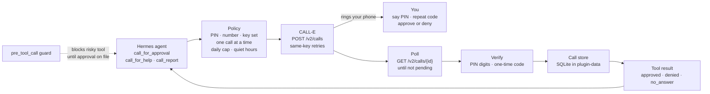

<h1 align="center">Hermes Call Me</h1>

**When Hermes runs on its own, how does it get a real yes from you before it does something it can't undo?**

<p align="center">
  
  
  
  
  
  
</p>

<p align="center">
  <b>Hermes plugin</b> · Real phone calls through CALL-E · No runtime dependencies · Fails closed: a missing answer is never a yes
</p>

| |
| --- |
| [The problem](#the-problem) · [What it does](#what-hermes-call-me-does) · [How it works](#how-it-works) · [Architecture](#architecture) · [Before you install](#before-you-install) · [Setup](#setup) · [Countries](#countries) · [Tools](#the-three-tools) · [Guard](#optional-risky-tool-guard) · [Configuration](#configuration) · [Security](#security) · [Cost](#cost) · [Layout](#repository-layout) · [Checks](#checks) · [Troubleshooting](#troubleshooting) · [Scope notes](#honest-scope-notes) |

## The problem

You leave Hermes running on a deploy, a cleanup or a payments job, and you walk away. Sooner or later it reaches a step that should not happen without you: dropping a table, pushing to production, moving money. It can stop and wait in a terminal nobody is watching, or it can guess.

A chat message is easy to miss and easy to fake. A model reading a transcript can decide you "sounded fine with it". What Hermes needs is a channel that reaches you anywhere and gives back a verdict the plugin checked, not one the model inferred.

## What Hermes Call Me does

It gives Hermes three tools. Each one places a real phone call through [CALL-E](https://www.heycall-e.com) to **one allowlisted number**, yours:

- **`call_for_approval`.** Before a risky action, Hermes calls you, reads out what will change, and waits for approve or deny.
- **`call_for_help`.** When it is stuck on a production problem, it explains what broke and what it tried, and takes your instructions.
- **`call_report`.** When it finishes, it tells you what it did, what is left and where things stand.

Every call starts with your **spoken PIN, which the plugin compares**. The CALL-E agent never knows the PIN. An approval also needs a one-time code read to you during the call and repeated back. A wrong PIN, a wrong code, no answer, busy, silence, a vague answer or a timeout always comes back as **not approved**.

## How it works

1. **The tool is called.** Hermes calls `call_for_approval(action, risk, summary)`, or one of the other two tools.
2. **Policy check.** Before CALL-E is contacted, the plugin checks:
   - a PIN, your E.164 number and a CALL-E key are all set
   - the text from the model is under 1,000 characters per field
   - it's outside quiet hours, if you turned them on
   - no other call is active and the daily cap (default 8) is not reached; these two are checked in the same database transaction that records the call, so parallel tool calls can't both get through

   If any check fails, nothing is dialed.
3. **Place the call.** `POST /v2/calls` with the task, your number (CALL-E infers the country from it, so a +1 number is called as US), a closed result schema, and an `Idempotency-Key`. If acceptance is uncertain (a lost response, a 5xx, or `409 creation_in_progress`), the same body and key are replayed, which [never dials twice](https://docs.heycall-e.com/calls#idempotency).
4. **Wait.** `GET /v2/calls/{id}` every two seconds while `result_status` is `pending`, for up to `call_timeout_seconds` (default 180).
5. **Verify.** The plugin compares the PIN digits you said with your PIN and, for an approval, the code you repeated with the one it generated. Only then does it read your decision.
6. **Record.** The decision and outcome go into the plugin's SQLite database, with the transcript's spoken numbers redacted and the one-time code wiped. The tool result holds only the checked fields, never the transcript. An approval is stored as **single use** and expires after 10 minutes.

## Architecture



**Decision rule:**

```
approved   PIN matched AND one-time code matched AND you said approve
denied     you said deny · wrong PIN · wrong code · answer could not be read
no_answer  no answer · busy · declined · cancelled · failed · timeout · error
approved is true only for "approved"; nothing else counts as a yes
```

## Before you install

What the plugin does on your machine, so you can decide before enabling it:

| What | Detail |
| --- | --- |
| **Third-party network calls** | `https://api.heycall-e.com` only. The action summary (or issue, or report), your number and the call task are sent to CALL-E. CALL-E processes the call audio; the plugin gets back the transcript and the structured result. Your PIN is never sent. |
| **Paid calls** | Every tool call is a real phone call billed to your CALL-E account. It only dials `HERMES_CALL_ME_OWNER_NUMBER`, one call at a time, at most 8 a day by default. |
| **Stored data** | `<HERMES_HOME>/plugin-data/hermes-call-me/data.db` holds decisions, outcomes, single-use approvals and transcripts, with spoken PINs and codes replaced by `[number]`. |
| **Credentials** | `CALLE_API_KEY` and `HERMES_CALL_ME_PIN` are secret fields, read through Hermes's secret store for the active profile. Other settings come from the active profile's plugin config. The plugin never reads `.env` files or any other credential store. |
| **Waiting for a person** | A tool call waits at most `call_timeout_seconds` (default 180, max 600), then returns `no_answer`. Unattended runs are not left hanging, and the plugin never approves anything itself. |
| **Not included** | No local server, no inbound calls, no shell commands, no telemetry, no self-update. |

## Setup

Requires Hermes Agent **0.21.6** or newer and a CALL-E account.

1. Sign up at [heycall-e.com](https://www.heycall-e.com) and create an API key in the [dashboard](https://dashboard.heycall-e.com/account/api-keys). The CALL-E integrations README and product FAQ say new accounts get **100 free credits (US$1)**.
2. Install and enable the plugin:

```bash
hermes plugins install https://github.com/fozagtx/hermes-call-me
hermes plugins enable hermes-call-me
```

3. In the plugin's settings, set:
   - **CALL-E API key** (secret)
   - **Owner PIN**, 4 to 12 digits (secret)
   - **Owner number**, the one number to call, in E.164 such as `+14155550100`

Leave **region** and **locale** blank. CALL-E works out the country from your number, so a +1 number is called as US, and the call asks for English. If your country isn't on CALL-E's list, see [Countries](#countries).

4. Ask Hermes to call you, for example: *"Call me for approval before you deploy."* Pick up, say your PIN, listen to the change, repeat the code, and say approve or deny.

Registered with the plugin:

| Surface | Name |
| --- | --- |
| Tools | `call_for_approval` · `call_for_help` · `call_report` |
| Hook | `pre_tool_call` (risky-tool guard) |
| CLI | `hermes call-me recent` |
| Slash command | `/call-me` shows recent calls |
| Skill | `call-me`: when to call, and what not to trust |

## Countries

The plugin calls whatever country your number is in, as long as CALL-E covers it. These are the countries on [CALL-E's region list](https://docs.heycall-e.com/regions), checked 10 November 2026:

| Line | Countries | Notes |
| --- | --- | --- |
| **Local** | United States, Canada (+1) | Cheapest; the only prices CALL-E publishes |
| **International** | Australia, Bangladesh, Brazil, Finland, Germany, India, Indonesia, Japan, Malaysia, Mexico, Netherlands, Pakistan, Philippines, Poland, Singapore, Spain, Thailand, Turkey, United Kingdom, Viet Nam | A shared pool of numbers that CALL-E describes as mainly for development and testing; it may cost more, and its rates aren't published |

If your number is in another country, the plugin stops before dialing and says so. You have two ways forward.

### Your country isn't listed: use a US number that rings you

Get a US phone number that rings on your own phone wherever you are, and set it as the **owner number**. CALL-E sees a normal US call (the cheapest kind), and the plugin needs no changes.

- **Best: a calling app with a US number.** Calls arrive over mobile data or Wi-Fi in the app, so they work in any country with internet and cost no international forwarding fees.
- **Also works: a US number that forwards to your local SIM.** You pay the forwarding provider's per-minute rate to your country, and calls can lag a little.

Before you pick a provider, check that it lets you **receive** calls from abroad, and whether it charges for incoming minutes.

#### Doesn't that mean anyone who calls the number reaches me?

Yes. It's a real phone number, so anyone who has it can ring you, exactly like your own number. What they **can't** do:

- **They can't reach Hermes.** The plugin only places calls; it has no inbound path. Calling the US number just rings your phone.
- **They can't approve anything.** Approvals only come from calls Hermes started, and only after your PIN and the one-time code check out. A call you receive from someone else has nothing to do with the plugin.

To keep it quiet:

- **Use a number just for Hermes.** Don't make it your personal number, and don't publish or share it.
- **Turn off voicemail on it,** or keep it, if you like: voicemail can't say your PIN, so a missed call always comes back as `no_answer`.
- **Use the app's call blocking** for anyone who finds the number. Be careful with "contacts only" or "silence unknown callers": CALL-E may ring from different numbers, and a silenced call is a missed approval (`no_answer`, never a yes).
- **Prefer a fresh number** over a recycled one, so it isn't already known to someone else's contacts.

### Your country is enabled on your CALL-E account

CALL-E enables extra international regions after review, and its region page also mentions a SIP integration for unlisted destinations. If CALL-E has enabled your country for your account, set **region** to its two-letter code (for example `GH`). The plugin then skips its own country check and lets CALL-E decide.

## The three tools

| Tool | You hear | Hermes gets back |
| --- | --- | --- |
| `call_for_approval(action, risk, summary)` | The action, risk and summary, a one-time code, then "approve or deny?" | `result`: `approved`, `denied` or `no_answer`, plus `approved` true or false |
| `call_for_help(issue, what_i_tried)` | The problem and what was tried, then "what should I do?" | `instructions`, or `null` with a `reason` if the PIN failed or the answer was unclear |
| `call_report(done, left, progress)` | The report, then "do you acknowledge it?" | `delivered` true or false, and `reply` if you left one |

The PIN never appears in the task sent to CALL-E. Neither the PIN, the one-time code nor the transcript appears in a tool result.

## Optional risky-tool guard

Off by default. Turn on **Risky-tool guard** (`HERMES_CALL_ME_GUARD=1`) when Hermes runs unattended.

The `pre_tool_call` hook then blocks any tool whose name matches the built-in patterns or your own **Risky tool patterns**. The built-in list covers deploy, destroy, delete, drop, purge, wipe, payment, payout, refund, charge, transfer, terraform, kubectl and migrate. To get past the block, the model must call `call_for_approval` with `action` set to that tool's exact name. A yes can be used once and expires after 10 minutes by default. Only the plugin's own three tools are exempt from the guard.

The hook doesn't place the call itself. Hermes gives a hook about 30 seconds and a call can take about 3 minutes, so the hook only checks whether an approval is already on file.

## Configuration

Set everything in Hermes's plugin settings. Inside Hermes, environment variables are ignored, so one profile can't pick up another's values. The environment variable names below are used only outside Hermes (tests, `python -m hermes_call_me`).

| Setting | Env | Default | Notes |
| --- | --- | --- | --- |
| CALL-E API key | `CALLE_API_KEY` | none | Secret. Required. |
| Owner PIN | `HERMES_CALL_ME_PIN` | none | Secret. 4 to 12 digits. Required. |
| Owner number | `HERMES_CALL_ME_OWNER_NUMBER` | none | One E.164 number. The only number dialed. Required. |
| Region · locale | `HERMES_CALL_ME_REGION` · `HERMES_CALL_ME_LOCALE` | blank · blank | Blank lets CALL-E infer them from the number (+1 is US). Set the region only for a country CALL-E enabled on your account. |
| Call timeout | `HERMES_CALL_ME_TIMEOUT_SECONDS` | `180` | 30 to 600 |
| Daily cap | `HERMES_CALL_ME_DAILY_CAP` | `8` | Rolling 24 hours; counts calls CALL-E accepted |
| Quiet hours | `HERMES_CALL_ME_QUIET_HOURS` · `_ENABLED` | `22:00-07:00` · off | Overnight ranges allowed |
| Timezone | `HERMES_CALL_ME_TIMEZONE` | `America/New_York` | IANA name |
| Guard | `HERMES_CALL_ME_GUARD` · `HERMES_CALL_ME_RISKY_TOOLS` | off · built-in list | Regular expressions on tool names |
| Approval lifetime | `HERMES_CALL_ME_APPROVAL_TTL_SECONDS` | `600` | Single use, at least 30 |

## Security

The full threat model, the known limits and how to report a problem are in [`SECURITY.md`](SECURITY.md). In short:

- **The PIN is checked by the plugin.** CALL-E's agent never knows it, and an approval also needs a one-time code repeated back.
- **The model never sees the PIN, the code or the transcript.** Transcripts are stored with spoken numbers redacted.
- **Text from the model is treated as data.** It's capped at 1,000 characters and quoted so it can't instruct CALL-E's agent.
- **No double calls.** One call at a time and the daily cap are enforced atomically, and retries never redial.
- **The guard fails closed.** An unreadable guard setting turns it on.

## Cost

From CALL-E's [billing page](https://docs.heycall-e.com/billing) and its 2026-09-24 changelog, checked 8 November 2026. Prices change.

| | US / CA one-shot call |
| --- | --- |
| **Rate** | $0.0296 per 10 s of model time + $0.04/min carrier, rounded up to the minute |
| **60 s call** | $0.2176 (CALL-E's own worked example) |
| **30 s call** | $0.1288 |
| **Three ~60 s calls** | about $0.65, inside the 100-credit (US$1) signup credit |
| **Not published** | International carrier rates; preparation fees on a call nobody answers |

Goal runs cost half as much, but a Goal must be published in CALL-E first and can't take a new task and result schema per call. Approval, help and report each need their own wording, so the plugin uses one-shot calls.

## Repository layout

```
hermes-call-me/
├── plugin.yaml                # manifest v2: tools, hook, secret config, requires_hermes
├── __init__.py                # Hermes entry point, re-exports register
├── hermes_call_me/
│   ├── plugin.py              # register(ctx): tools, hook, skill, commands. No network
│   ├── schemas.py             # what the model sees
│   ├── tools.py               # handlers: JSON strings, errors instead of raises
│   ├── service.py             # approval, help and report flows
│   ├── calle.py               # CALL-E client: create with same-key retries, poll, cancel
│   ├── calle_call.py          # task text, result schema, PIN and code checks
│   ├── policy.py              # PIN compare, daily cap, quiet hours, risky patterns
│   ├── hooks.py               # pre_tool_call guard
│   ├── config.py              # settings, secrets through Hermes
│   ├── store.py               # SQLite call log and single-use approvals
│   ├── cli.py · __main__.py   # hermes call-me recent / python -m hermes_call_me
│   └── context.py             # the Hermes plugin context
├── skills/call-me/SKILL.md    # when to call, and what not to trust
├── tests/                     # pytest; all HTTP is stubbed
├── .github/workflows/tests.yml
├── .env.example               # names for running outside Hermes
├── SECURITY.md                # threat model, known limits, reporting
└── LICENSE                    # MIT
```

## Checks

```bash
python3 -m venv .venv
.venv/bin/pip install -e '.[dev]'
.venv/bin/python -m pytest -q
hermes plugins validate . --install-deps   # the same check the plugin catalog runs
```

The tests cover:

- that the declared tools and hooks match what `register` actually registers
- the `POST /v2/calls` request shape: number, closed schema, no PIN in the task, and region and locale left out unless you set them
- that listed countries pass, and an unlisted country is refused before dialing unless you set its region
- replaying the same body and key after a lost response or `409 creation_in_progress`, and not retrying a `422` or a changed-input `409`
- PIN and one-time-code checks: a wrong code, busy or no answer is never approval
- that a poll timeout returns `no_answer` and never redials
- that an approval is single use, and that the guard exempts only the plugin's own tools
- one call at a time, the daily cap, quiet hours across midnight
- that secrets are read through Hermes's secret scope, ahead of the process environment
- that a missing key, PIN or number, or an over-long summary, fails before any HTTP request
- that parallel calls can't both be reserved (eight threads, one call)
- that spoken PINs and codes are redacted from stored transcripts and never returned to the model
- that model text can't close its quote markers in the CALL-E task
- that, inside Hermes, profile config wins over the process environment

## Troubleshooting

**`Set HERMES_CALL_ME_PIN. No call was placed.`**
Every call needs a PIN of 4 to 12 digits. Set it in the plugin settings.

**`HERMES_CALL_ME_OWNER_NUMBER must be one E.164 number`**
Use `+`, the country code and the number, with no spaces, for example `+14155550100`.

**`CALLE_API_KEY is not set. No call was placed.`**
Create a key in the [CALL-E dashboard](https://dashboard.heycall-e.com/account/api-keys) and set it as the plugin's API key secret.

**`CALL-E does not list the country of +233... as a calling region`**
Your number's country isn't on CALL-E's list. Use a US number that rings you (see [Countries](#countries)), or set the region if CALL-E enabled your country.

**`CALL-E POST .../v2/calls failed (422, input_incomplete)`**
Usually a region you set doesn't match the owner number. Clear the region so CALL-E infers it, or check the missing inputs CALL-E lists in the message.

**`CALL-E POST .../v2/calls failed (422, unsupported_region)` or `unsupported_language`**
That region or locale has no calling line on your account. See [Regions](https://docs.heycall-e.com/regions).

**`Daily call cap reached (8 of 8 in the last 24 hours).`**
Wait, or raise the daily cap deliberately.

**`Quiet hours are 22:00-07:00 (America/New_York). No call was placed.`**
Quiet hours are on. Call outside that window or turn them off.

**`A call is already in progress (...). Nothing new was dialed.`**
Only one call runs at a time. A call stuck well past the timeout (timeout plus 5 minutes) is cleared automatically on the next attempt.

**`summary is 1234 characters; the limit is 1000`**
The model sent too much text for one call. Ask Hermes for a shorter summary.

**`CALL-E call ... was still pending after 180s.`**
The tool returned `no_answer` and did not redial. The call may still finish on CALL-E's side; check the dashboard before asking Hermes to call again.

## Honest scope notes

- **Approval means a spoken PIN, not identity.** Anyone who knows the PIN and answers your phone can approve. Use a PIN you don't use anywhere else.
- **Whoever answers hears the summary.** CALL-E's agent can't check the PIN mid-call, so the summary is read after any digits are said. Keep secrets out of it.
- **An approval covers a tool name, not its arguments.** One approved `deploy_prod` lets one `deploy_prod` call run within 10 minutes, whatever its arguments.
- **Hermes calls you; you can't call Hermes.** CALL-E's API doesn't receive inbound calls, so there is no inbound path.
- **The hook doesn't place the call.** The guard only checks for an approval on file. The model has to call `call_for_approval` first.
- **What Hermes says is sent to CALL-E.** Whatever goes in `summary`, `issue` or `done` is read aloud on the call and processed by CALL-E.
- **Costs are published figures, not quotes.** Some rates aren't public; these are listed under [Cost](#cost).
- **No live call was placed in CI.** The tests stub HTTP against the documented contract. The first real call is yours.

## License

MIT. See [`LICENSE`](LICENSE).
